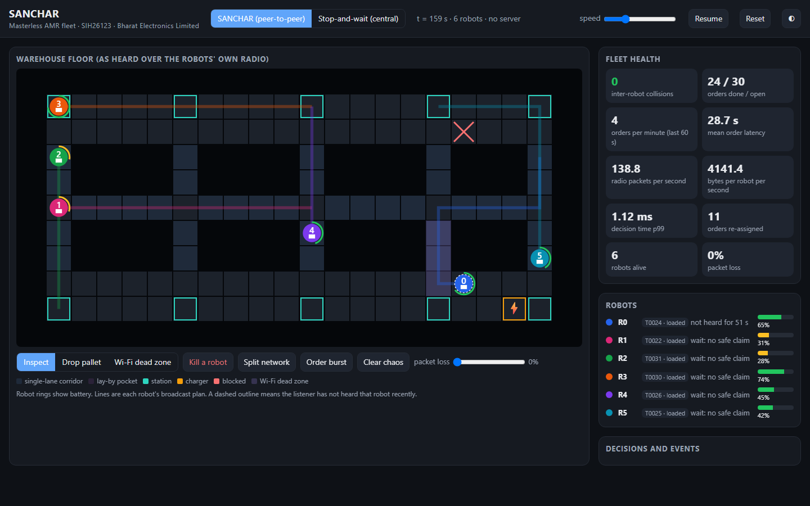

# SANCHAR: an AMR fleet with no master (SIH 2026 · SIH26123 · Bharat Electronics Limited)

Every robot runs the identical edge node. It plans its own path, negotiates right-of-way with
peers over a signed peer-to-peer radio protocol, and bids for orders in a leaderless market.
There is no fleet server, no leader and no broker. The dashboard only listens.



## Results (30 seeds per scenario, 95% confidence intervals)

Makespan reduction versus stop-and-wait, counting only seeds where both methods finished (the
conservative figure). Full table: `bench/results/summary.md`.

| Scenario | SANCHAR vs stop-and-wait |
|---|---|
| 6 AMRs, overlapping paths (the PS criterion; target 20%) | 25.0% ± 4.8% faster, better in 30/30 seeds |
| Pallet blocks an aisle | 29.1% ± 4.5% faster |
| 12 AMRs, overlapping paths | 55.9% ± 5.6% faster |
| Live orders, robots allocate them themselves | 43.2% faster, order latency 62% lower |
| Live orders plus blocked aisle / robot crash / 30% packet loss / Wi-Fi dead zone | 44.6% / 37.8% / 38.6% / 22.6% faster |
| Single-lane 4-way intersection (stress test) | stop-and-wait gridlocked in 30/30 runs; SANCHAR finished all |
| Isolated two-way chokepoint (our weak case) | 16.4% slower than perfect-information central zone control |

SANCHAR had zero collisions and zero unfinished runs across all 330 runs. The simulation engine
counts every collision independently of the policy.

## Quick start

```bash
pip install msgspec numpy pytest hypothesis
python -m sanchar.dashboard.server --port 8080      # open http://127.0.0.1:8080
python -m pytest -q                                   # 43 tests: safety, protocol, CRDT, market
python -m bench.run_bench --seeds 30                  # regenerates bench/results/ (about 5 minutes)
pip install playwright edge-tts imageio-ffmpeg      # only for the demo video
python docs/video/build_video.py --team-name "..." --team-id "..."      # 3-minute captioned demo video
```

## How it works

- **Radio.** Signed Hello (position, next-node claim, priority, battery, acknowledgements),
  Intent (path), Seen (sightings), task records and bids. Two rounds per 1 s move (10 Hz on
  hardware), with multi-hop relays and short-range links that survive Wi-Fi dead zones.
- **Motion.** Decentralized Guided-PIBT, the algorithm family that won the 2023 League of Robot
  Runners, with swap resolution, yield mode, corridor and mouth gates for choke points, a
  deterministic wait-for cycle breaker and a randomized last-resort escape.
- **Safety.** A robot enters a node only if it claimed it in the previous round, every peer
  recently acknowledged hearing it, and no fresh claim or stale peer's reach set conflicts. This
  holds under packet loss, relays and crashes. See `docs/DEADLOCK_FREEDOM.md`.
- **Orders.** Auction bids with consensus-free awards on a CRDT task board. Orders are re-assigned
  when a route is blocked or an owner goes silent, and drop-offs redirect around blocked stations.
- **Edge-AI.** The AI planning and negotiation above runs on each robot. An optional on-robot
  learned ETA predictor (ridge regression on radio-derived congestion features) is in
  `sanchar/edge_ai/`. It gives 10% lower ETA error and 4.6% faster completion on a 12-robot floor.
- **Real processes.** `python -m sanchar.sim.runner --robots 6 --kill 2@40` runs one OS process
  per robot over UDP and kills one mid-run; the rest deliver every order.

Docs: `docs/ARCHITECTURE.md`, `docs/DEADLOCK_FREEDOM.md`, `docs/BASELINE.md`.
